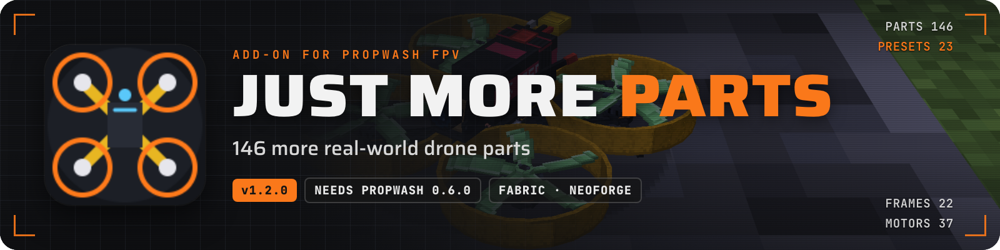

**146 more real-world drone parts for Propwash FPV.** From 65 mm whoops over toothpicks and cinewhoops, 5″ freestyle
and race quads and 6 to 8″ long range up to 13″ X-Class: motors, props, batteries, stacks, video systems and frames in
new shapes. On top come 23 ready-to-fly presets.

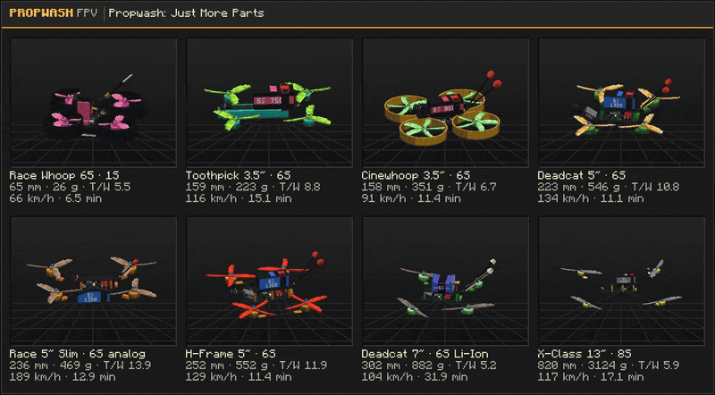

[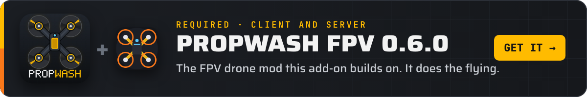](https://modrinth.com/mod/propwash-fpv)

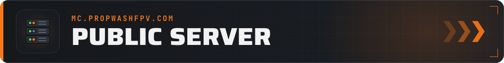

Play Propwash with others on our public server **`mc.propwashfpv.com`**. Since Propwash 0.6.0 you can join with
**Fabric or NeoForge**. Add the address to your server list; if the server needs a mod you don't have, the join screen
names it.

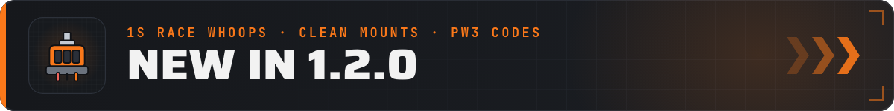

- **Three 1S race-whoop motors.** 0702 with 30000 and 35000 KV for 65 mm whoops, 0802 with 27200 KV for 75 mm whoops, each based on data sheets from at least three makers. Hold full throttle too long and they get hot and lose power.
- **New preset: Race Whoop 65 · 1S.** Built around the 35000 KV motor: very snappy, short flights, and it wants a battery with a high C rating.
- **Clean battery mounts.** With the battery in, all 22 frames show no plugs or cables.
- **Share codes from Propwash.** The add-on's own share window is gone, because Propwash's PW3 codes cover every part.
- **Motor heat.** Cooling is tuned to the new motor heat of Propwash 0.6.0. Every frame takes the accessories of its Propwash counterpart, with a front mount on 18 frames.

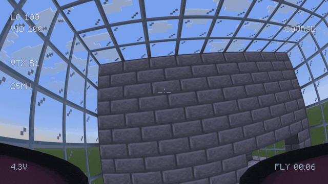

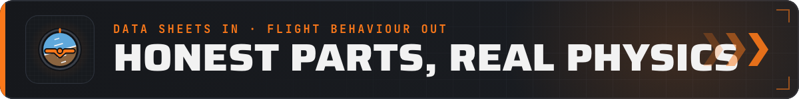

Just More Parts fakes nothing. Every part is a data sheet with real-world numbers (weight, stator size and KV, winding
resistance, heat limits, thrust and power coefficients, cell count, capacity, C rating, internal resistance, wheelbase,
arm layout, drag), and **Propwash's own flight model turns them into flight behaviour**. The trade-offs appear by
themselves:

- a two-blade prop flies longer, a five-blade prop pulls harder and draws more current
- a Li-Ion pack hovers for half an hour and has no punch; a semi-solid pack is light but overloaded at full throttle
- a 4S stack on 6S burns out when you arm
- a deadcat or H-frame keeps the props out of your camera view; a stretched X rolls faster and flips slower
- an X-Class quad is heavy and slow to turn, and it flies for a long time

Hold **Shift** over any part: the tooltip lists its key figures, pros, cons and what it is good for.

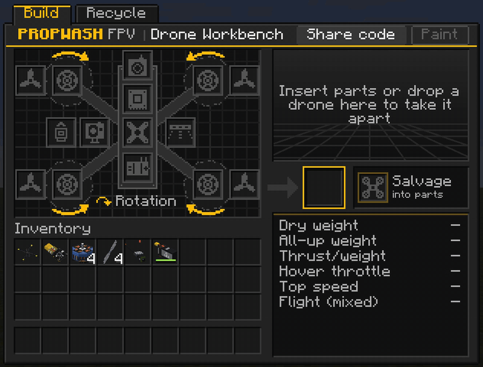

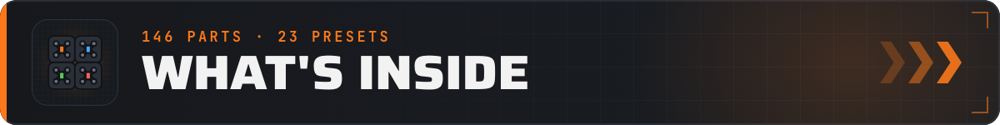

| | Count | Range |
|---|---|---|
| Motors | 37 | 0702 to 4214, 35000 KV down to 330 KV, 1S race-whoop motors |
| Props | 38 | 31 mm to 13″, 2 to 5 blades, PC, bi-blend, nylon, carbon, ducted |
| Batteries | 30 | 1S 250 mAh to 8S 5000 mAh: LiHV, LiPo, Li-Ion, semi-solid LiHV |
| Cell chemistry | 1 | semi-solid LiHV (up to 4.45 V per cell) |
| Stacks / AIOs | 12 | 1S whoop AIO to 30×30 8S 100 A |
| Video systems | 7 | analog 25 mW to 1.6 W, digital micro to long range |
| Frames | 22 | whoops, toothpicks, cinewhoops, 5″ in five shapes, long range 4 to 8″, X-Class 10/12/13″ |
| Presets | 23 | painted, ready to fly, in their own creative tab |

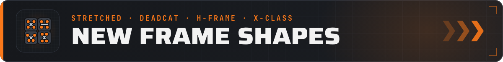

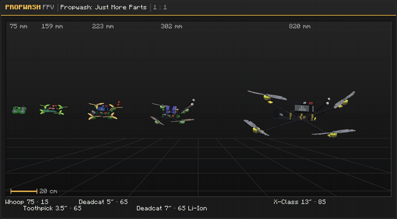

- **Five shapes, same parts.** True X, stretched X, squashed X, deadcat and H-frame, flown with a mixer for the real arm layout. The Flight School lesson *Frame shapes compared* shows the difference.
- **X-Class up to 13″.** Heavy, slow to turn and long-flying. X-Class parts are uncommon or rare and only appear in late structures.
- **Ducts like real ones.** Whoops and cinewhoops have thin walls and round rings, and you see them in the lower corners of your FPV view.

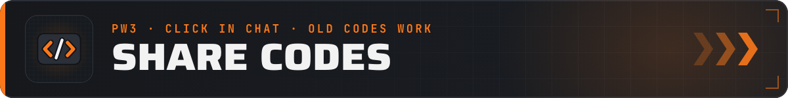

Share codes come from Propwash 0.6.0, and its **PW3** codes know every Just More Parts part. A code carries any mix of
parts, paint, flight tune, OSD layout and name.

- **One place for all codes:** the *Share code* button at the Drone Workbench, the *Share code* tab (`K`) or `/propwash code`.
- **Codes name their add-ons:** without Just More Parts, paint, tune and OSD still apply, and every part has a Propwash stand-in.
- **Click in chat:** hover a code another pilot posted to see the drone, click to open it in the import.
- **Old codes keep working:** PW1 and PW2 codes still load and convert to PW3 with one click.

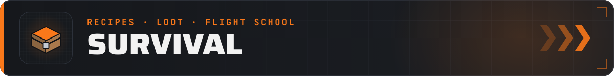

- **Recipes and loot.** Every part has a recipe (bigger parts cost more) and turns up in chests from village houses to end cities.
- **Flight School.** The Flight School key (`M`) opens the matching lessons over every Just More Parts item, just like over Propwash's own parts.

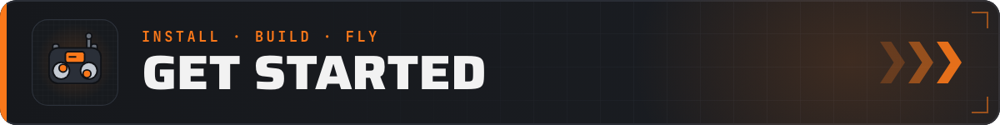

1. Put **Propwash FPV 0.6.0** and Just More Parts **1.2.0** into the same `mods` folder (Fabric or NeoForge), on the
   client and on the server.
2. Grab a preset from the add-on's creative tab, or craft the parts in survival.
3. Build at Propwash's **Drone Workbench**. The new parts sit next to Propwash's own, and the live analysis shows
   weight, thrust and flight time as you go.
4. Bind it, put on your goggles and fly. Hold **Shift** over a part for its figures, or **M** for its lesson.

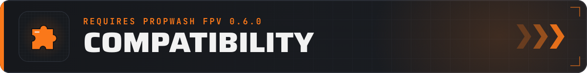

- Minecraft 26.3 · Fabric (Fabric API required) or NeoForge · Java 25
- **Propwash FPV 0.6.0 or newer** ([download](https://modrinth.com/mod/propwash-fpv)), on the client **and** the server. Propwash 0.6.0 won't start with Just More Parts 1.1.x, so update both together.
- Install it on the server and on every client, in the same version. On a server without it, the add-on simply stays off.
- Your worlds, drones and settings stay as they are. Remove the add-on and drones keep its parts as *Unknown part* until it comes back.
- English and German

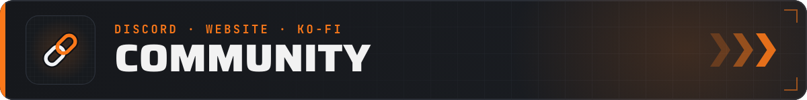

  

Questions, builds, a part you miss? Join the Discord or read the docs on the website. Propwash and its add-ons are
free; if you enjoy them, you can support the project on [Ko-fi](https://ko-fi.com/propwashfpv). Thank you!

*NOT AN OFFICIAL MINECRAFT PRODUCT. NOT APPROVED BY OR ASSOCIATED WITH MOJANG OR MICROSOFT.*
